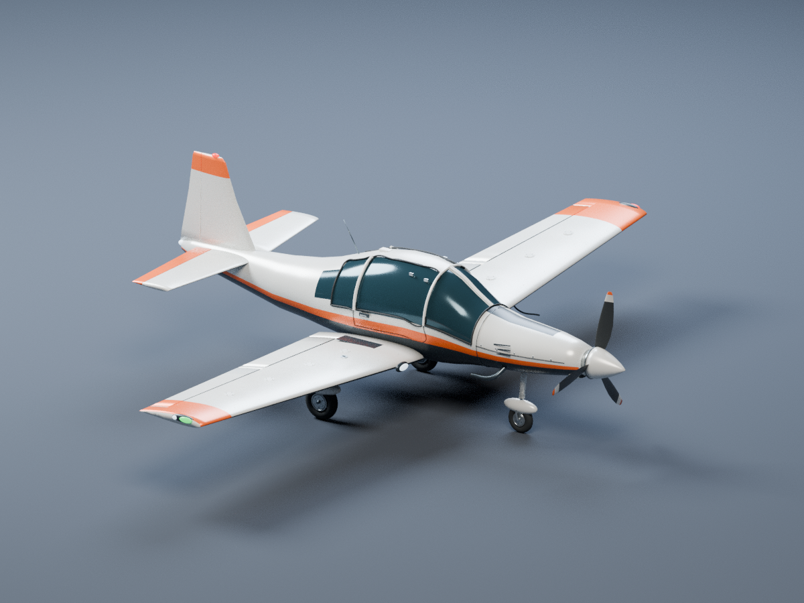

# Enduro, Helikopter & Flugzeug – Blender-Python-Generator

Ein eigenständiges Python-Skript erzeugt drei detaillierte, markenfreie Fahrzeugmodelle: eine Sport-Enduro, einen leichten Mehrzweckhelikopter und ein einmotoriges Sport-/Reiseflugzeug mit Tiefdeckertragflächen und festem Dreibeinfahrwerk. Alle Geometrien und Oberflächentexturen entstehen lokal; Modell-Downloads, API-Schlüssel und kostenpflichtige Dienste werden nicht benötigt.



**Voraussetzung:** Blender **4.3 oder neuer** mit Cycles und dem mitgelieferten glTF-Exporter. Getestet mit Blender 4.3.2. Zusätzliche Python-Pakete müssen nicht installiert werden.

## Start

Im Repository-Verzeichnis:

```bash
python3 generate_vehicles.py --asset all --output generated --render
```

Das Skript startet `blender` aus dem `PATH`. Alternativ den Blender-Pfad direkt verwenden, zum Beispiel unter Windows `"C:\Program Files\Blender Foundation\Blender 4.3\blender.exe"` anstelle von `blender`:

```bash
blender --background --factory-startup --python-exit-code 1 --python generate_vehicles.py -- --asset all --output generated --render
```

Der Generator läuft absichtlich in einem eigenen Hintergrundprozess. Jede Asset-Szene wird dort neu angelegt. Eine bereits geöffnete Blender-Arbeitssitzung bleibt erhalten.

Nur ein Fahrzeug, mehr Samples für die Vorschau und größere Oberflächentexturen:

```bash
python3 generate_vehicles.py --asset enduro --output generated_detail --texture-size 512 --samples 96 --resolution 1600 --render
```

Nur das neue Flugzeug erzeugen:

```bash
python3 generate_vehicles.py --asset airplane --output generated --render
```

`--asset helicopter` erzeugt nur den Helikopter. `--asset all` ist der neue Standard und erzeugt alle drei Modelle; `--asset both` bleibt kompatibel und erzeugt weiterhin ausschließlich Enduro und Helikopter. Ohne `--render` werden keine Vorschaubilder berechnet. `--lods 1`, `2` oder `3` bestimmt die Anzahl der Detailstufen; Standard ist `3`. `--seed 7` steuert reproduzierbar die Mikrostruktur der Materialien, nicht die Fahrzeugform. Bestehende, nicht leere Asset-Ordner werden nur mit `--force` verwendet. Dabei werden bekannte Ausgabedateien überschrieben und nicht mehr angeforderte LODs/Vorschaubilder entfernt; andere Dateien bleiben erhalten.

## Ergebnis

Pro Fahrzeug entsteht ein Unterordner:

| Datei | Inhalt |
| --- | --- |
| `enduro.blend` / `helicopter.blend` / `airplane.blend` | Bearbeitbare Bauteile, Drehpunkte, Materialien, versteckte LODs/Kollisionskörper und Renderstudio |
| `*_LOD0.glb` | Vollständige Geometrie, für den Export nach Material und Bewegungsgruppe zusammengefasst |
| `*_LOD1.glb`, `*_LOD2.glb` | Automatisch vereinfachte Geometrie; tatsächliche Dreieckszahlen im Manifest |
| `*_collision.glb` | Separate grobe, konvexe Box-Kollisionskörper |
| `*_preview.png` | Optionales Cycles-Studiobild |
| `manifest.json` | Maße, Dreieckszahlen, Herkunft, Generator-Hash, Dateigrößen, SHA-256-Prüfsummen und Grenzen des Modells |

Die `.blend`-Datei zeigt die detaillierte `*_SOURCE`-Collection. Die `*_LOD…`-Collections und Kollisionskörper sind zunächst ausgeblendet. `STUDIO_RENDER_ONLY` enthält Kamera, Beleuchtung und Boden und gehört nicht zum GLB-Export.

Die Enduro enthält Speichenräder, modellierte Stollen, Bremsscheiben mit Aussparungen, Motor/Kühlrippen, Rahmen, Federbein, Schwinge, Kette, Auspuff, Verkleidung, Sitzbank, Lenker und Leitungen. Räder und Lenkung haben eigene Drehpunkte. Der Helikopter enthält einen geformten Rumpf, dunkle Cockpit- und Türverglasung, Dichtungen, Kufen, Turbinenverkleidung, Leitwerke, profilierten Haupt-/Heckrotor und separate Rotor-Drehpunkte. Seine Verglasung ist **opak**; eine ausgearbeitete Innenkabine ist nicht enthalten.

Das Flugzeug ergänzt einen geformten Rumpf, profilierte Tragflächen, Dreiblattpropeller mit Spinner, Fahrwerk mit drei Rädern, Querruder, Landeklappen, Höhen- und Seitenruder sowie Cockpitverglasung, Lufteinlässe und Positionslichter. Zehn Drehpunkte trennen Propeller, Räder und Steuerflächen für spätere Animationen. Auch hier ist die Verglasung **opak** und es gibt keine ausgearbeitete Innenkabine oder Flugsimulation.

PBR-Materialien verwenden Basisfarben sowie eingebettete Metallic-/Roughness- und feine Normaltexturen. Das sind generische Mikrostrukturen, keine von einem High-Poly-Modell gebackenen Detailmaps. UVs werden automatisch pro Quellbauteil erstellt. Die nachträgliche Zusammenfassung beim Export kann UV-Überlappungen zwischen Bauteilen erzeugen; die wiederholbaren Mikrotexturen sind darauf ausgelegt. Die UVs sind keine eindeutigen Textur- oder Lightmap-Atlanten.

## Engine-Übergabe

Maßstab ist **1 Einheit = 1 Meter**. Blender: **+X vorwärts, +Y links, +Z oben**. Der GLB-Exporter wandelt standardgerecht zu glTF um: **+X vorwärts, −Z links, +Y oben**. Eine Unreal-/Unity-Importkonvertierung kann weitere Achsen-/Einheitenanpassungen übernehmen; die Maße im Manifest dienen als Referenz.

Die Dateien einzeln in den glTF-fähigen Importer der Ziel-Engine übernehmen. LOD0/1/2 müssen dort als LOD-Stufen zugewiesen werden. Kollisionskörper müssen separat zugeordnet werden; die `UCX_`-Namen allein garantieren bei glTF keine automatische Unreal-Kollision. Rad-Drehpunkte rotieren um ihr lokales Y, die Lenkung um das geneigte lokale Z, der Hauptrotor um Z und der Heckrotor um Y in der Blender-Quelldatei. Nach der Achsenkonvertierung die importierten lokalen Achsen prüfen. Die Metadaten `part_role` erleichtern die Zuordnung.

Beim Flugzeug rotiert der Propeller um sein lokales X, die drei Räder um Y, Querruder/Landeklappen/Höhenruder um ihre jeweils ausgerichtete lokale Y-Achse und das Seitenruder um seine lokale Z-Achse. Die Kollisionskörper sind statische Näherungen; Propellerbewegung und Steuerflächen benötigen eigene Engine-Einstellungen.

Das Ergebnis ist eine detaillierte **prozedurale Ausgangsbasis für eine Spieleproduktion**. Eine AAA-Abnahme ist damit nicht verbunden. Für ein finales Hero-Asset sind insbesondere Silhouetten-/Nahansichtsprüfung, manuell abgestimmte Retopologie und LODs, eindeutige UV-Atlanten, High-Poly-Bakes, gestaltete Abnutzung, Innenraum bei Bedarf, Rig/Animation, Fahrzeugphysik, passende Kollision und Tests in der Ziel-Engine nötig. Collider folgen in der separaten Exportdatei noch keiner Rad- oder Rotoranimation. Anzahl der Materialien, Draw Calls und Speicherbudget müssen zur konkreten Plattform passen.

Formen und Bauteile werden direkt in `build_enduro()`, `build_helicopter()` und `build_airplane()` im Skript angepasst. `Builder.mat()` definiert Materialien und Mikrotexturen, `export_lod()` die Vereinfachung und Exportzusammenfassung.

## Prüfung

```bash
python3 tools/validate_exports.py generated
python3 -m unittest discover -s tools -p 'test_*.py' -v
blender --background --factory-startup --python-exit-code 1 --python tools/smoke_blender.py -- generated
```

Der unabhängige Validator prüft GLB-Struktur, Hierarchie, Referenzen, gültige Dreiecksindizes, endliche Geometriewerte, Normalen/UVs, eingebettete Bilder und abnehmende LOD-Dreieckszahlen. Er gibt JSON auf stdout aus und beendet sich bei Fehlern mit einem Fehlercode. Er bewertet weder Ästhetik noch Fahrzeugphysik und ersetzt keinen Engine-Test.

Der Blender-Smoke-Test importiert LOD0 und Kollisionen in frische Szenen. Er vergleicht Dateihashes, Maße und Dreieckszahlen mit dem Manifest und liest die eingebetteten Texturen. Er rotiert jeden Drehpunkt probeweise, prüft die Bewegung seiner Bauteile sowie die unveränderte Position unabhängiger Geometrie und setzt die Szene anschließend zurück.

Die mit Blender 4.3.2 erzeugten Standardmodelle haben folgende Dreieckszahlen:

| Modell | LOD0 | LOD1 | LOD2 | Kollisionskörper |
| --- | ---: | ---: | ---: | ---: |
| Enduro | 142.576 | 70.568 | 32.030 | 4 Boxen |
| Helikopter | 85.220 | 41.216 | 17.673 | 6 Boxen |
| Flugzeug | 97.120 | 47.464 | 20.825 | 8 Boxen |

Andere Blender-Versionen können bei automatischer Vereinfachung und UV-Erstellung abweichende Ergebnisse liefern. Die aktuellen Zahlen stehen immer in den erzeugten Manifesten.

Code und vollständig prozedural erzeugte Inhalte stehen unter der MIT-Lizenz dieses Repositorys; siehe `LICENSE`.
