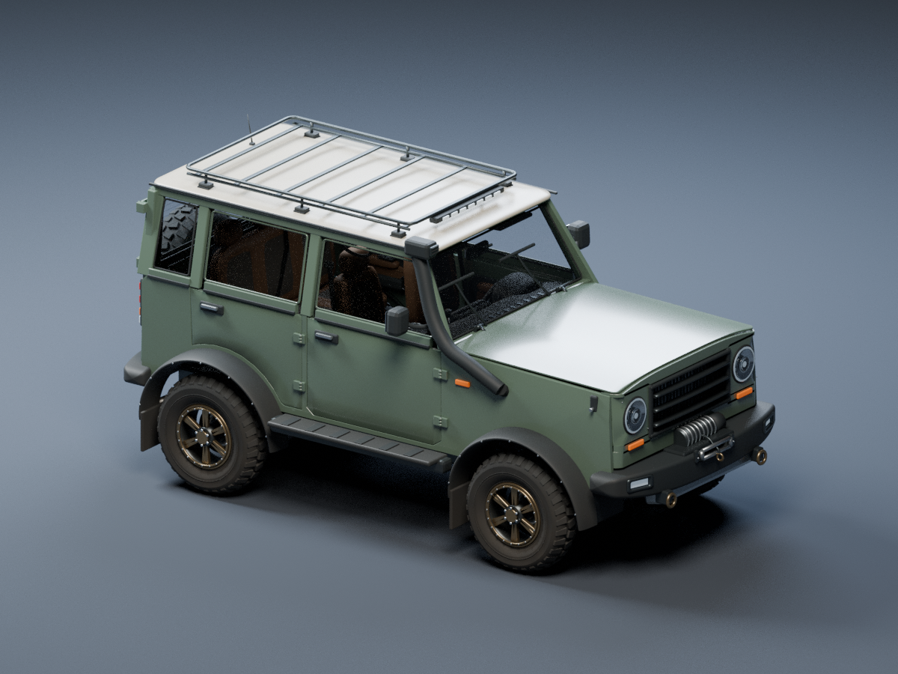
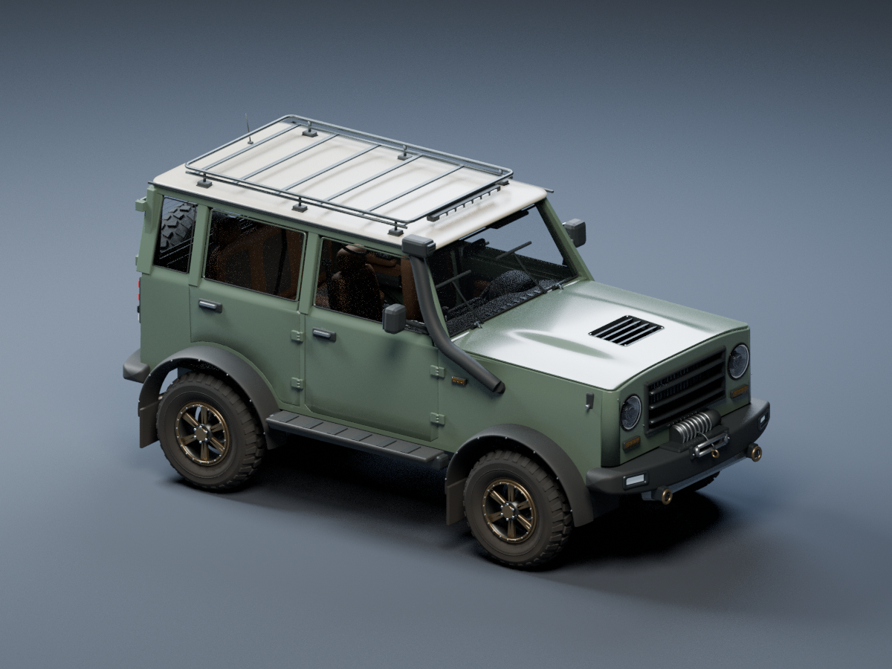
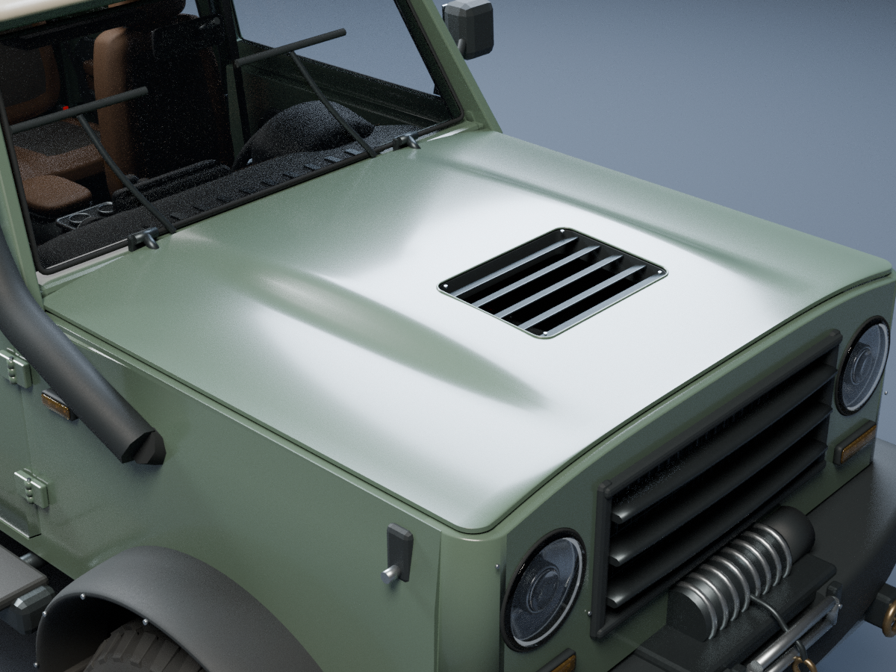
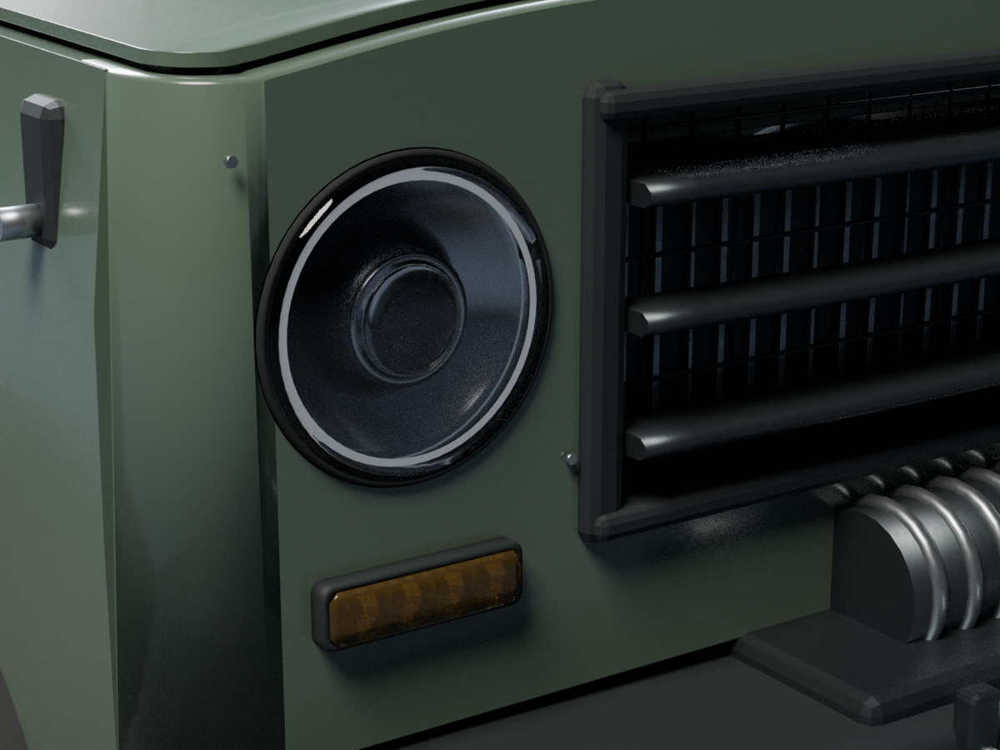
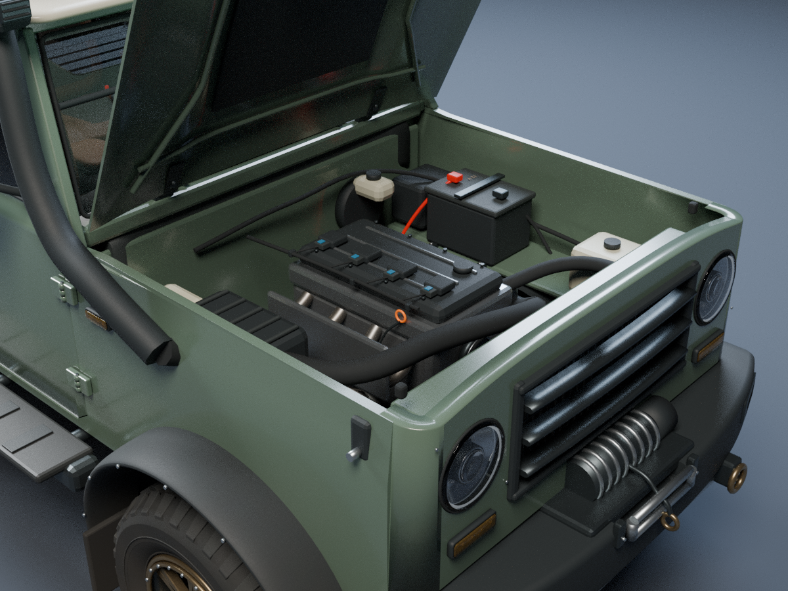
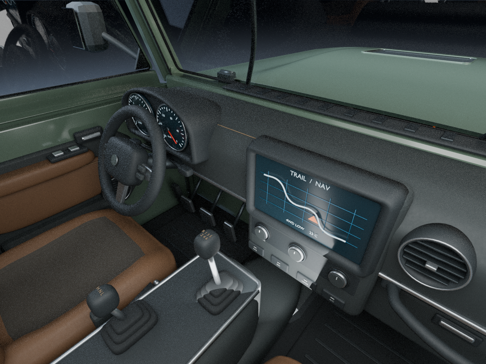
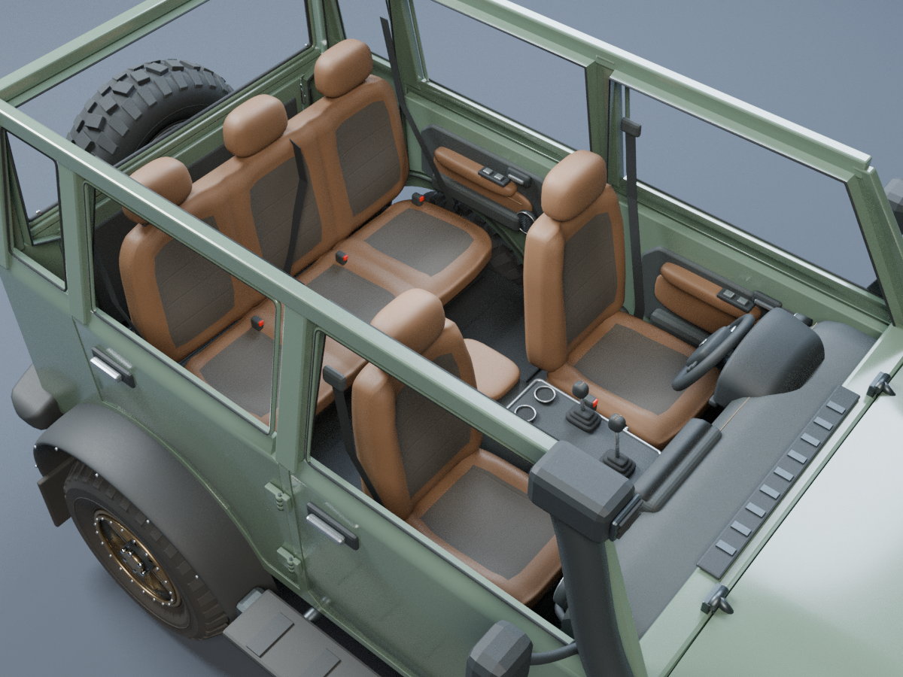
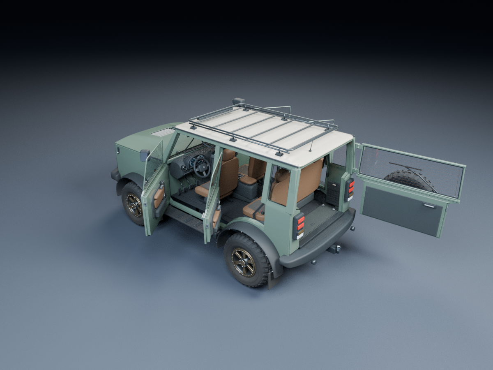

# Überarbeiteter Offroader

Der Offroader besitzt jetzt einen deutlich erhöhten Haubenmittelteil mit einer echten, lamellenbestückten Luftöffnung. Die drei im Nutzerbild markierten Fensterunterkanten gehen als geformte Blechkanten in Türen und hintere Seitenwand über; die breiten aufgesetzten Leisten entfallen. Die Front und die festen Seitenwände bilden eine zusammenhängende Schale mit gerundeten vorderen Ecken. Kleine dreieckige Spiegelaufnahmen verbinden die Halter mit den Vordertüren.

Vier öffnende Türen, Hecktür, modellierter Motorraum, detailliertes Cockpit und alle 19 Drehpunkte bleiben erhalten. Die Ausgangsmaße sind 2,64 m Radstand, 1,84 m Spurweite und 0,86 m Reifendurchmesser. Geometrie, Beschriftungen und Oberflächentexturen entstehen lokal im Python-Generator. Das Fahrzeug ist ein eigener Entwurf, keine maßgetreue Nachbildung eines bestimmten G-Klasse-Modells.

| Vorher: flache Haubenwirkung und breite Fensterleisten | Jetzt: geformte Haube, Luftöffnung und integrierte Fensterkanten |
| --- | --- |
|  |  |





| Motorraum bei geöffneter Haube | Blick aus der Kabine |
| --- | --- |
|  |  |





Die beiden Außenansichten verwenden denselben Kamerawinkel. Die Schnittansicht blendet Dach, Scheiben und zugehörige Anbauteile nur im Render aus. Im Blender-Modell und in den GLBs sind sie vorhanden. Die Cockpitansicht öffnet die tatsächliche Beifahrertür um 60°, damit Licht in die Kabine fällt; dabei wird keine Geometrie ausgeblendet. Die Zugangsansicht zeigt die vier Türen bei jeweils 55° und die Hecktür bei 95°. Alle sieben aktuellen Ansichten werden aus den tatsächlichen Modellflächen gerendert.

## Erzeugen und prüfen

```bash
python3 generate_vehicles.py --asset offroader --output generated --render --resolution 1200 --samples 256 --texture-size 512
blender -b --python-exit-code 1 --python tools/render_offroader_details.py -- --asset-dir generated/offroader --resolution 1200 --samples 256
python3 tools/validate_exports.py generated/offroader
blender -b --python-exit-code 1 --python tools/smoke_blender.py -- generated/offroader
blender -b --python-exit-code 1 --python tools/check_offroader_access.py -- generated/offroader/offroader.blend
blender -b --python-exit-code 1 --python tools/check_offroader_tangents.py -- generated/offroader/offroader.blend
blender -b --python-exit-code 1 --python tools/check_offroader_fit.py -- generated/offroader/offroader.blend
blender -b --python-exit-code 1 --python tools/check_offroader_refinement.py -- generated/offroader/offroader.blend
```

Bei einem bereits gefüllten Ausgabeordner muss der Generator zusätzlich `--force` erhalten. Der Detailrenderer prüft den Hash der Quelldatei und erzeugt sechs zusätzliche PNGs: Motorraum, Cockpit, Innenraumschnitt, geöffnete Türen, eine Nahaufnahme von Haube und Front sowie eine Leuchtendetailansicht. Zusammen mit der Außenansicht entstehen sieben Bilder mit 1200 × 900 Pixeln. Der Renderer trägt Dateihashes, Renderparameter, verwendete Drehwinkel und die Kennzeichnung der Schnittansicht im Manifest ein. Die Quelldatei bleibt unverändert.

## Bauteile

- **Haube:** ein zusätzlich um bis zu 45 mm erhöhter Mittelbereich mit zwei ausgeformten Schultern; am geprüften Querschnitt liegt die Mitte rund 84 mm über dem seitlichen Rand. Eine 340 × 490 mm große Öffnung geht durch Außenhaut und Dämmung. Fünf geneigte Lamellen, ein schmaler gerollter Rand, kleine Halter und ein offener Kanal darunter sind modellierte Geometrie und bewegen sich mit der Haube. Die Öffnung belüftet den Motorraum; sie ist nicht an den weiterhin vom Schnorchel versorgten Motorluftfilter angeschlossen. Die Unterseitenverstärkungen folgen der neuen Kontur ohne die Außenhaut zu durchstoßen. Gefalzte Kante, Dämmung, Scharniere und Schloss bleiben erhalten; der vordere Haubenspalt wird an fünf Stellen geprüft.
- **Karosserie und Türen:** in die Türhaut integrierte, nach innen gerollte Fensterunterkanten mit schmalen Dichtungen ersetzen die separaten Fensterleisten. Die hintere Seitenscheibe erhält denselben Übergang. Die Front läuft mit 100 mm Eckradius in die festen Seitenwände; diese Flächen bilden eine einzige verbundene, geschlossene Schale. Dreieckige Spiegelaufnahmen sitzen an den unteren vorderen Scheibenecken. Dazu kommen rund 18–19 mm gewölbte Türhäute und zusätzlich 35 mm Einzug je Seite am oberen Kabinenrand. Vier vollständige Türblätter in echten Öffnungen mit gefalzten Blechkanten, zurückgesetzten Dichtungen, Fenstereinfassungen, Scharnieren, Schlossdetails und festen Schließbügeln. Innenverkleidung, Griffe, Scheibe und bei den Vordertüren der Außenspiegel bewegen sich mit dem jeweiligen Türblatt. Geformte Säulen und glatte Radlaufwölbungen bleiben am Fahrzeugkörper.
- **Dach und Stoßfänger:** eine gewölbte Dachschale mit etwa 32 mm Randstärke, rund 105 mm Eckradius und schlankeren Trägerfüßen. Die Stoßfänger laufen weich um die Ecken; Nebelleuchten sitzen in Vertiefungen, die Winde auf einem integrierten Träger.
- **Hecktür und Gepäckraum:** seitlich angeschlagene Hecktür mit Reserverad und Träger, Heckscheibe, Wischer, innerem Griff und Verkleidung. Zehn Heizdrähte mit zwei Sammelleitern liegen auf der Scheibe. Im flachen Gepäckraum bleiben Teppichboden, Griff der Bodenplatte, vier Verzurrösen, Seitennetze, Leuchten und Ladekante am Fahrzeugkörper befestigt.
- **Scheinwerfer und Grill:** eine geschlossene, 2,5 mm dünne und leicht gewölbte klare Abdeckung sitzt vor einem separat modellierten Projektor, Reflektorschale, Befestigungslaschen und schmalem Lichtleiter. Die Scheinwerfer sind in den Frontöffnungen versenkt; die Abdeckung steht maximal 24 mm vor dem Blech. Optische Aluminiumoberflächen und ein zurückhaltender Lichtleiter lösen die Bauteile voneinander. Der schmalere Grill besitzt leicht gewölbte Lamellen; dahinter liegen ein feines Gitter und der modellierte Kühler.
- **Blinker:** zwei vordere, zwei seitliche und zwei hintere Module besitzen getrennte Gehäuseränder, facettierte Reflektormulden, kleine orange Lichtkörper und rund 2 mm starke gewölbte Abdeckungen mit inneren Prismenrippen. Die orangefarbenen Abdeckungen sind transparent und leuchten nicht selbst. Die Gehäuse berühren ihre jeweiligen Karosserie- beziehungsweise Rückleuchtenaufnahmen. Ein zeitgesteuertes Blinksignal und Beleuchtungssteuerung gehören zur späteren Engine-Integration.
- **Motorraum:** Reihenvierzylinder mit Kopf/Deckel, Ölwanne, Ansaug- und Abgaswegen, Riementrieb, Lichtmaschine, Luftfilter, Kühler/Lüfter, Batterie, Sicherungskasten, Flüssigkeitsbehältern und Leitungen. Schlauchschellen folgen der jeweiligen Schlauchrichtung; Spulenstecker, Kabelhalter, Batterieträger und Luftfilterclips ergänzen die Anschlüsse.
- **Cockpit:** eine längs und quer geformte Mittelkonsole mit eingefasster Ablage und gerundeter zentraler Armlehne; geformtes Armaturenbrett mit gerundeten Übergängen, gewölbter Instrumentenhaube und überstehender Blendschutzkante. Bildschirm, Klimabedienung und Schalter sitzen in vertieften Einfassungen; die Luftausströmer besitzen offene Vertiefungen. Dazu kommen beschriftete Rundinstrumente, eine originale statische Routengrafik, manuelle Sechsgangschaltung mit Rückwärtsgangbeschriftung, Verteilergetriebehebel, Handbremse und drei Pedale.
- **Kabine:** zwei Vordersitze und eine durchgehende Rückbank für drei Personen. Ihre sechs Kissen- und Lehnenformen sind jeweils geschlossen und verbinden Seitenwangen, Oberschenkelauflage, Sitzmulden sowie Lenden- und Schulterkonturen. Weiche Vorderkanten, leicht eingedrückte Sitzmulden und verjüngte Kopfstützen runden die Polsterform ab. Stoffflächen gehen bündig in die Lederbereiche über. Stoffstruktur, vertiefte Nähte und kleine Falten sind in Normalmaps gespeichert. Dazu kommen Kopfstützen, Gurte, Türablagen, Fensterheberschalter, Lautsprecher, Innenspiegel, Sonnenblenden und Haltegriffe.
- **Verglasung:** klare, geschlossene Scheibenkörper mit dezent grün getönten Kanten, separaten Dichtungen und modellierter Stärke: rund 6 mm an den Seiten und hinten, rund 7,6 mm an der Frontscheibe. Die Heizdrähte sind sichtbare Geometrie ohne thermische Simulation.
- **Reifen:** abgeschrägte Profilblöcke schließen an die Reifenschulter an. Eigene geprägte Beschriftung `TRAIL A/T` und `285/75 R17` liegt auf einem gemeinsamen Normal-/Rauheitsatlas; die Nennmaße passen zum modellierten Reifendurchmesser. Alle vier Räder und das Reserverad tragen die Beschriftung.
- **Oberflächen:** nichtmetallischer Unilack mit Klarlackschicht, mattere Kunststoffe und Leder sowie getrennte Gewebe- und Gummifinishes verwenden eigene Normal-/Rauheitsmaps in auf Meter bezogenem Maßstab. Die Polsterkarte besitzt mindestens 1024 × 1024 Pixel und zusätzliche Doppelnahtfäden mit etwa 3 mm Stichabstand. Zurückhaltende Bremsscheibenriefen, Anlassfarben am Auspuff, Unterbodenschmutz und glattere Kontaktstellen an Griffen und Trittflächen ergänzen das Materialbild.

Die vorderen Sitzmitten sind seitlich auf ±0,42 m gesetzt; die Fahrerposition liegt damit auf der Lenkradachse. Zwischen den Pedalachsen liegen jeweils 150 mm. Eine feste linke Fußstütze, kleinere geformte Schaltknäufe und konturierte Türverkleidungen ergänzen den Innenraum. Diese Maße und Stichproben der Bewegungsfreiheit ersetzen keine Ergonomieprüfung mit einem konkreten Spieler- oder Fahrermodell.

## Drehpunkte im Blender-Quellmodell

| `part_role` | Lokale Achse | Vorgesehene Bewegung |
| --- | --- | --- |
| `hood_hinge_pivot` | Y | 0 bis −72°, Haube öffnen |
| `cabin_steering_pivot` | X | −540 bis +540°, geneigte Lenksäule |
| `gear_lever_pivot`, `transfer_lever_pivot` | Y | −12 bis +12°, Hebel vor/zurück |
| `handbrake_pivot` | Y | 0 bis −25°, anheben |
| `accelerator_pivot`, `brake_pivot`, `clutch_pivot` | Y | 0 bis −18°, treten |
| vier `*_wheel_pivot` | Y | Radrotation |
| zwei `front_*_steering_pivot` | Z | Vorderradlenkung |
| `front_left_door_hinge_pivot` | Z | 0 bis −70°, linke Vordertür öffnen |
| `rear_left_door_hinge_pivot` | Z | 0 bis −65°, linke Hintertür öffnen |
| `front_right_door_hinge_pivot` | Z | 0 bis +70°, rechte Vordertür öffnen |
| `rear_right_door_hinge_pivot` | Z | 0 bis +65°, rechte Hintertür öffnen |
| `tailgate_hinge_pivot` | Z | 0 bis +100°, Hecktür samt Reserverad öffnen |

Alle 19 Drehpunkte sind starre Bauteilhierarchien. Die Tabelle nennt ihre Achsen; Haube, Kabinenbedienelemente, Türen und Hecktür tragen zusätzlich Winkelgrenzen als Metadaten. Die Dateien enthalten keine Animationsclips. Die Engine muss diese Bewegungen an Eingaben koppeln und die lokalen Achsen nach dem Import prüfen. Ein seitliches Schaltgassenverhalten kann zusätzlich am Ganghebel angesteuert werden; es gibt dafür keine fertige Schaltsimulation. Manschetten und Fahrwerksfederung bleiben statisch. Der Motor ist sichtbare Geometrie; innere Kolben, Verbrennung, Fahrphysik und Sounds werden nicht simuliert.

Die Türen besitzen noch keine Spiellogik für Öffnen, Schließen, Verriegeln oder Einsteigen. Die zehn separaten Kollisionsboxen sind grobe statische Näherungen. Sie folgen weder Rädern noch Türen oder Hecktür; auch der Reserverad-Collider bleibt statisch. Für Spielereinstieg und bewegte Türen müssen passende Kollisionen in der Ziel-Engine angelegt werden, insbesondere muss die massive Kabinenbox ersetzt werden.

## Darstellung und Budget

Der Lack verwendet `KHR_materials_clearcoat`, Scheiben und Scheinwerfer `KHR_materials_transmission`. Oberflächenkörnung und Gewebe liegen als eingebettete Bildtexturen vor. Sitzflächen und Reifenbeschriftung erhalten eigens ausgerichtete UVs; der gemeinsame Reifenatlas und die Bremsscheibenmap haben mindestens 1024 × 1024 Pixel, unabhängig von der Basistexturauflösung. Zusätzliche UV-Ebenen halten die feine Oberflächenkörnung im passenden Maßstab, ohne die vorhandenen Naht- und Reifenatlanten umzupacken. Vertexfarben (`COLOR_0`) tragen dezente Staubspuren, Unterbodenschmutz und Anlassfarben; der Importer muss sie zusammen mit den PBR-Texturen auswerten. Die Beleuchtung ist nicht in diese Maps eingebrannt.

Kleine Beschriftungen, Schrauben und Gitterdetails verschwinden gezielt aus entfernten LODs; Reifenprägung und Heckscheibenheizdrähte entfallen in LOD2. Alle beweglichen Baugruppen bleiben erhalten. Die tatsächlichen Dreiecks-, Mesh- und Dateigrößen stehen im jeweiligen Manifest.

Die Vorschauen verwenden zusätzliche weiche Studiobeleuchtung in der Kabine. Diese Leuchten werden nicht als Fahrzeugbestandteile exportiert. OpenImageDenoise wird nur aktiviert, wenn der verwendete Blender-Build es unterstützt; im hier verwendeten Blender 4.3.2 ist es nicht eingebaut. Die Renderbefehle oben verwenden deshalb bis zu 256 Samples ohne Denoising. Die tatsächlichen Einstellungen stehen im Manifest.

Der Blender-Test prüft alle 19 Drehpunkte, die reale Tiefe der Türfugen, den Sitz der Scheinwerfer und die UVs der fünf Reifenatlanten. Er kontrolliert außerdem die mitbewegten Türverkleidungen, das Reserverad und die Heizdrähte, die feste Anbindung der Gurtaufnahmen, die sechs geschlossenen Sitzpolsterformen und die Stärke der Kabinenscheiben.

Der Zugangstest prüft sechs Öffnungswinkel je Tür und Hecktür, einschließlich 5° und 10° kurz nach dem Öffnen, auf Flächendurchdringungen mit Karosserie, Innenraum und den übrigen geschlossenen Türen. Die festen Hecktürscharnierblätter werden zusätzlich auf Kontakt zu ihren Karosserieaufnahmen geprüft. Vorgesehene Kontaktflächen an Scharnieren und Schlössern sind von der Bewegungsprüfung ausgenommen; die Prüfung ersetzt keine kontinuierliche Kollisionssimulation. Der Tangententest vergleicht die exportierte Normalmap-Ausrichtung an einem Stoff-/Ledersitz und einer Bremsscheibe numerisch mit den jeweiligen Material-UVs und prüft, dass die ursprünglichen UVs erhalten bleiben.

Die automatische UV-Verteilung ist kein eindeutiger Texturatlas. Ein finales Spielbudget hängt von Sichtabstand, Anzahl gleichzeitig sichtbarer Fahrzeuge und Engine ab. Der Blender-Roundtrip prüft Geometrie, Texturen und Drehpunkte; ein Godot-/Unreal-/Unity-Laufzeittest ist damit nicht ersetzt.

Der zusätzliche Passungstest prüft sechs Haubenstellungen gegen benannte benachbarte Karosserie- und Motorraumflächen sowie 15 Hebel-/Pedalstellungen gegen Sitzpolster, Armlehnen und Türverkleidungen. Er kontrolliert auch den vorderen Haubenspalt, den Kontakt der beiden festen Haubenscharnieraufnahmen zu Windlauf und Scharnierstift sowie die seitliche Sitz-/Lenkradausrichtung und die Pedalachsabstände. Die Prüfung umfasst diese ausdrücklich genannten Flächen und Stichproben.

Der Formtest prüft zusätzlich die durchgehende Luftöffnung in Haube und Dämmung, den offenen Kanal, die Anbindung aller Einlassteile an den Haubendrehpunkt, kollisionsfreie Unterseitenverstärkungen, vier integrierte Türkanten und den Kontakt der Spiegelarme zu ihren Aufnahmen. Die verbundene Frontschale wird auf genau eine zusammenhängende Komponente, geschlossene Flächen, positives Volumen und entartete Flächen geprüft.

Der Leuchtentest kontrolliert die tatsächliche mittige Wandstärke aller acht optischen Abdeckungen per Strahlabfrage, geschlossene Flächen und transparente, nicht selbstleuchtende Deckmaterialien. Die sechs Blinker werden zusätzlich auf Kontakt zu ihren Montageflächen geprüft.
